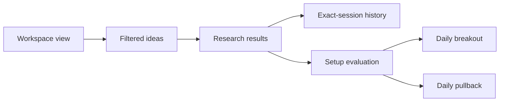

# Graph-based improvement review

Date: 22 October 2026. Scope: recommendations only, including how the earlier
four-hour breakout proposal fits the current app. No application code changed.

## Recommendation

Prioritize usable, explained daily Trade Ideas and a verified data path. Reuse
the implemented swing architecture if a four-hour strategy is added later.
The 5 October breakout plan predates the S1–S6 swing implementation and should
be reconciled before its B1 phase starts. The user's complete-four-hour-only
decision remains valid; this review does not change that decision or any rules.

The daily breakout and proposed four-hour breakout are different hypotheses.
Shared infrastructure is useful, but their eligibility rules, timestamps, data
requirements, result identities and validation cohorts must remain distinct.

## What the two graphs established

Graphify's existing graph contains 1,799 nodes and 5,876 edges, with file
modification timestamp 22 October 2026 07:08 UTC. It is navigation evidence,
not proof that every working-tree edit has been indexed. CodeGraph returned
current source for the specific integration points used below.

Graphify vocabulary expansion: `swing breakout validation coverage provider
scheduler cache operations performance chart risk ledger`. Targeted follow-ups
used existing vocabulary tokens `research`, `coverage`, `workspace`, `forward`.
The broad query was truncated; focused queries were used for supporting edges.
The literal `breakout` query found no nodes. That is a lexical search limitation,
not evidence that the breakout implementation is absent.

Observed Graphify connections include:

- `app/swing/api.py:L12` imports `SwingResearchService`.
- `app/swing/api.py:L18` contains `ResearchResponse`, which refers to `Plan`
  and `Rejection`; those type-use edges are marked INFERRED, not runtime proof.
- `app/swing/data.py:L196` calls `coverage()` from `import_snapshot()`.
- `app/swing/workspace_api.py:L117` calls workspace/presentation helpers from
  the ideas route. Current source was used to establish the subsequent flow.

CodeGraph's current source confirms this main research path:



Already implemented in the working tree:

- `app/swing/setups.py:85`: daily breakout/pullback evaluation with trend,
  benchmark regime, relative strength, liquidity, volume and ATR extension checks.
  Rule-derived entry ranges, stops and cost-aware reward/risk are included.
- `ui/swing.py:59`: candlestick charts with compatible entry/stop/target overlays.
- `app/swing/workspace.py:94`: source quality, failure counts and snapshot CSV.
- `ui/swing.py:129`: per-stock source coverage and inspection-only archive charts.
- `ui/swing.py:279`: forward reconciliation monitor; `ui/swing.py:310`:
  independent validation reports.
- `app/scheduler/runner.py:299`: background outcome/replay/alert work already
  uses the shared reservation/lock. A second scheduler is unnecessary.

## Prioritized improvements

### 1. P0 — Make the source-data path usable and evidence-backed

The existing archive is intentionally inspection-only where evidence is missing.
`SwingResearchService.results` requests raw history (`app/swing/service.py:50`),
while `SwingRepository.history` rejects unresolved/mismatched basis and missing
exact sessions (`app/swing/repository.py:108`). The current cache adapter does
not attest identity or trading basis; no header override should bypass this.

Recorded evidence from 16 October reports 497 universe members, 241 with price
observations, zero complete trailing histories, zero eligible swing histories
and no configured Nifty 500 benchmark observations. The 17 October S6 check
records zero prospective sessions. These are dated records, not a new live
assessment of today's data.

Recommended work: define a supplemental provider/import contract for supported
price-basis evidence, historical identity, explicit availability timestamps,
complete benchmark observations and required context. Add coverage-diff reports
between vintages and map each blocker to the exact missing fields/sessions.
Use an independently evidenced adapter; retain the current adapter's unknowns.
Actual source choice and access should be resolved before implementation.

Acceptance: the old unverified cache remains unverified; a genuinely evidenced
source can satisfy the typed history/context requests; all gaps/revisions remain
visible. Inspection usability and historical validation readiness are separate.
No fabricated constituent history, benchmark substitution or weaker gates.

### 2. P1 — Explain empty results and rule decisions accurately

`ui/swing.py:183` always attributes an empty plan list to missing source evidence.
However, `evaluate` can return ordinary filter rejections with valid histories
(`app/swing/setups.py:116`, `:156`). These are different user situations.

Recommended work: derive the empty state from source failures, normal rule
rejections, and eligibility gates separately. Show one clear next action and
counts. For available inputs, expose rule name, observed value, operator,
threshold and pass/fail outcome from the backend. Existing rejection names are
a useful starting point, but do not fully explain how far a condition missed.

Acceptance: good data with no matching setup says so; missing benchmark/history
shows the source blocker; a research candidate awaiting proof is labelled
separately. Rule evidence and the selected snapshot agree. No UI-side duplicate
indicator calculations or changes to v1 inequalities.

### 3. P1 — Remove redundant work within a workspace request

`SwingWorkspace.view` calls `snapshot`, then `ideas`, which calls `snapshot`
and `research.results`, which calls `snapshot` again. Those paths ultimately
verify evidence hashes (`app/swing/workspace.py:94`, `:76`;
`app/swing/service.py:23`, `:39`; `app/swing/repository.py:84`).

Recommended work: pass a verified request context through these calls, with one
decision instant and consistent read scope. First eliminate duplicate reads and
hashing within the request. Benchmark before introducing cross-request caching.
If later justified, key calculation snapshots by vintage, strategy configuration,
implementation version and as-of/session boundary. Preserve integrity checks and
invalidate on evidence/configuration changes; do not cache mutable account state
or treat a historical request as if today's context were available then.

Acceptance: instrumented tests show one required verification per evidence item
per request; filters/export/charts remain consistent; a tampered artifact still
fails closed. No latency improvement is claimed until measured.

### 4. P1 — Improve the existing breakout chart and comparison view

The current daily chart already shows entry/stop/target levels. Add the actual
daily resistance level/window, observed volume/baseline and ATR extension as
backend-recorded annotations (`app/swing/setups.py:119`–`:126`). These would make
the existing setup easier to inspect without requiring hourly data.

Add a research comparison for current screener versus daily breakout/pullback:
unique candidates, overlap, rejection reasons and source coverage. Reuse the
existing validation/reconciliation machinery for subsequent outcome evidence;
report net returns/drawdown only when an entry convention and resolved evidence
exist. Candidate overlap alone does not demonstrate an edge. Distinguish a daily
strategy's conditions from the original prompt's body-based consolidation rule.

Acceptance: chart levels come from the exact selected plan/vintage and price
basis; missing context is visibly unavailable. Strategy cohorts and cost/entry
assumptions are explicit. No invented performance figures or retrospective use
of today's market cap as historical evidence.

### 5. P2 — Treat four-hour Breakout as an optional, isolated extension

Keep the confirmed complete-only aggregation, prior ten eligible candles and
eight-rule contract as a separately versioned hypothesis if hourly coverage and
the research workflow justify it. Reuse provider interfaces, chart presentation,
operations and validation utilities where their contracts fit.

Before introducing hourly data, change cache identity to include provider,
instrument, interval and adjustment basis. `BarCache` currently keys by ticker
only (`app/cache/bar_cache.py:16`) and its retention policy is daily-oriented.
Do not mix raw archive observations and adjusted Yahoo histories.

Reconcile the old prompt's absolute body formula, inclusive boundaries, INR
market-cap floor and signed distance-from-high semantics in the spec. The
20-day-or-50-day proximity rule is redundant under its proposed lower-bound
formula because the 50-day closing high is at least the 20-day closing high.
Simplifying the rule requires an explicit spec change, not a silent edit.

Schedule expensive work against the next eligible candle and publication grace,
respecting startup/manual/retry semantics. A repeatedly polled UI need not cause
a full-universe download. Benchmark hourly timestamp/finality/coverage behavior
before shipping, and preserve separate four-hour validation cohorts.

Acceptance: no cross-session grouping, no incomplete candles, no daily lookahead,
no cache collisions or change to legacy/daily strategy results. Reuse existing
global locking rather than adding a concurrent scan scheduler.

### 6. P2 — Add worker timing and wait visibility before further scheduling work

The global lock already coordinates scans, replay and alert delivery. Replay
processing can hold that lock for an entire accepted job
(`app/scheduler/runner.py:323`). Measure queue age, lock wait, task duration,
last progress and scan delay before expanding background workloads.

If measurements justify it, add bounded continuation at committed replay-session
boundaries so scans can regain priority. Preserve durable job IDs, idempotence,
shutdown draining and portfolio accounting. This is a scaling risk to measure,
not a demonstrated starvation bug.

## Suggested order

1. Freeze the new source/remediation contract and correct empty-state semantics.
2. Deliver backend rule evidence and daily breakout chart annotations.
3. Deduplicate request verification and measure workspace/worker timing.
4. Use existing S4/S6 tools once real source requirements are satisfied.
5. Revisit the hourly strategy after measuring incremental research value.

This review is not authorization to start all these phases. Implementation
remains one explicitly continued phase at a time under `docs/SPEC.md`.

## Verification record

- Application/configuration files: unchanged by this review. Existing dirty and
  untracked swing/macro work was preserved.
- Commands: Graphify `reflect --if-stale`, vocabulary extraction, focused `query`
  calls, CodeGraph source/flow queries, spec/evidence reads and Git status/diff.
- No graph rebuild, dependency installation, data import, live scan, campaign,
  alert delivery or deployment was performed.
- Graphify cost: existing graph reused; no new semantic-extraction API calls.
  Query/model token usage is not available from this environment; no token
  savings or monetary cost is asserted.
- Targeted setup test command (workspace-local TEMP/TMP and unique basetemp):
  `.venv/Scripts/python.exe -m pytest tests/test_swing_setups.py -q -p no:cacheprovider --basetemp <unique-workspace-temp>/pytest --tb=short`.
  Actual output: `26 passed in 8.88s`, exit 0.
- The broader command also included `tests/test_swing_api.py`,
  `tests/test_swing_ui.py`, `tests/test_scheduler.py`. It emitted 26 progress
  dots and then stalled at the API-test boundary. It was interrupted, exit 1;
  the cause is unconfirmed. It does not establish an API/UI pass or failure.
  A separate collection found `44 tests collected in 3.88s` and also emitted
  a Windows temporary-directory cleanup PermissionError. Collection is not a
  test pass. No application code was changed to work around these observations.
- Full-suite, current production-data readiness, browser behavior, API/UI tests,
  worker latency and trading performance remain NOT VERIFIED in this review.

## SPEC COMPLIANCE

| Sections | Status | Note |
|---|---|---|
| 0: phase/reporting discipline | Done | One recommendation review, no implementation phase advanced |
| 2, 6–8: integrity/universe/providers | Done | Existing unknowns and dated evidence distinguished |
| 14–15, 17–18: persistence/scheduler/API/UI | Done | Recommendations preserve existing contracts |
| 20: verification | Partial | Targeted checks only; full suite/live behavior not asserted |
| 26–31: swing extensions | Done | Existing functionality reused; readiness/validation gates retained |

```text
STATE SUMMARY
Completed: Graphify + CodeGraph recommendation review.
Created: docs/GRAPH_IMPROVEMENT_REVIEW.md — evidence-backed priorities.
Graphify: existing graph queried; local vocab/runtime/reflection helpers written.
Application code/configuration changed: none.
Public classes/functions/config keys added: none.
Key decision: improve the current daily research path before hourly expansion.
Preserved: complete-four-hour-only choice and all existing user changes.
Known limits: dated data checks, source blockers, no profitability evidence.
Tests: 26 setup tests passed; broader API/UI run stalled and was interrupted.
Next step: agree one improvement phase; reread docs/SPEC.md before implementing.
```
