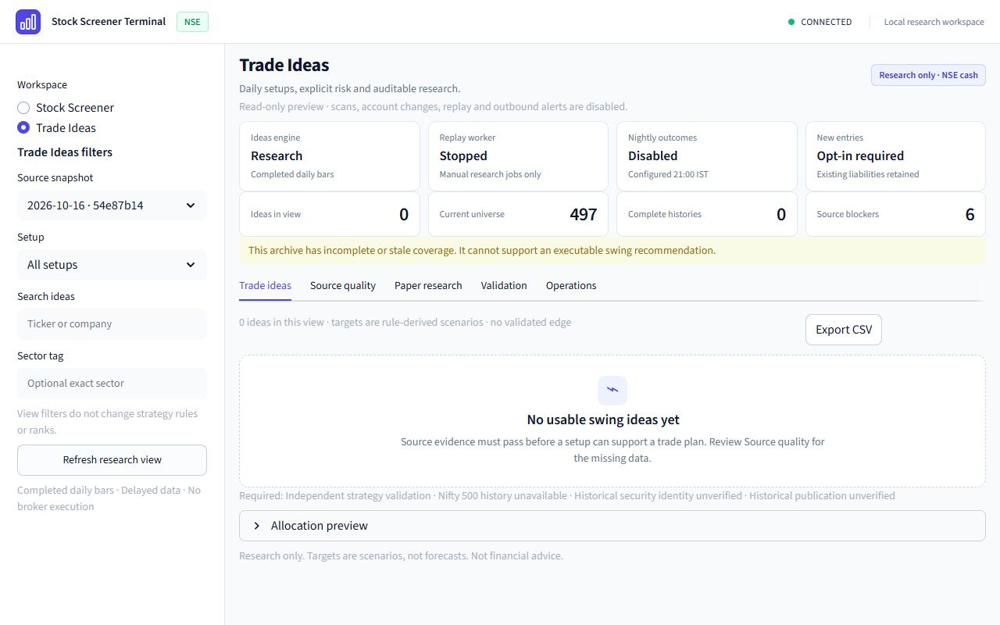

# S5 — Trade Ideas UI and operations

Implemented S5 only, 17 Oct 2026. The scanner now has a compact **Trade Ideas**
workspace with setup/sector/company filters, source inspection, reference charts,
consistent CSV export, account-based allocation previews, paper results, S4 report
views and operational controls. The real archive remains **RESEARCH_ONLY** with
zero eligible ideas. S6 prospective validation has not started.

## Delivered behavior

- Streamlit uses HTTP exclusively. Workspace reads do not fetch providers,
  initialize missing stores, create accounts or open terminal holdouts.
- Cards expose setup, session, entry interval, stop, target scenario, net reward/risk,
  expiry, evidence and missing gates. No account means no fabricated quantity.
  Server filters and ordering also drive allocation and CSV; the UI downloads CSV
  bundled with the exact displayed response.
- Charts show actual accepted observations and missing sessions. Unknown adjustment
  basis stays unknown and inspection-only; plan levels require matching known basis
  and vintage. Current company labels do not claim historical membership.
- Paper views retain unresolved liabilities and missing NAV. Explicit research
  submissions retain their request key after uncertain responses; queued jobs are
  tracked without automatically submitting a second intent.
- A separate append-only operations store records revisioned controls, idempotent
  receipts and alert delivery state. Pause blocks new work; rollback restores a
  recorded selection and forces pause. Financial events and strategy parameters
  are not rewritten. Shared worker locking prevents acknowledged-pause/fill races.
- Explicit management-only replay can maintain existing holdings while paused:
  no new entries/reservations/plans; known unfilled orders are cancelled, unknown
  liabilities retained, existing S3 exits/marks preserved.
- Lifecycle notifications require a dedicated configured URL and explicit opt-in.
  Existing event heads are snapshotted at opt-in. Stable event IDs, destination
  binding and claim-before-send survive restarts. Timeouts remain UNKNOWN until
  explicit review/retry; receivers must honor Idempotency-Key. Remote exactly-once
  delivery is not promised. Payloads omit account names, capital and quantities.
- Four status tiles stay in one desktop row and become two columns on narrow
  screens. The native sidebar toggle stays visible and reopens workspace filters.
  Operations displays actual scheduler/replay/outcomes states.

## Files created / modified

Created production modules: `app/swing/operations.py`, `app/swing/workspace.py`,
`app/swing/workspace_api.py`, `ui/swing.py`.

Modified integration: `app/main.py`, `app/scheduler/runner.py`,
`app/swing/ledger.py`, `app/swing/paper_service.py`, `app/swing/paper_api.py`,
`app/swing/replay.py`, `ui/api_client.py`, `ui/app.py`, `ui/styles.css`.

Created tests: `tests/test_swing_operations.py`, `tests/test_swing_ui.py`,
`tests/fixtures/swing_ui.py` (explicitly SYNTHETIC; test mocks only).

Updated `.env.example`, `README.md`, `docs/SPEC.md` section 30 and
`docs/SWING_TRADING_PLAN.md`. Created [contract](SWING_S5_CONTRACT.md), this report,
[real audit](swing/S5_REAL_CHECK.json) and three browser images below.
Ignored local helpers: `logs/swing_s5_preview.py`, `logs/swing_s5_real_check.py`.
Prior S1–S4/user changes were preserved; no commit, push or dependencies added.

Public entry points: `SwingOperations`, `OperationsSettings`, `SwingWorkspace`,
`filtered_plans`, `plans_csv`, the workspace API router and `ui.swing.render_swing`.
New environment defaults: `SWING_OPS_DB_PATH=data/swing_ops.db`,
`SWING_LIFECYCLE_WEBHOOK_URL=` (empty), `SWING_LIFECYCLE_TIMEOUT_SEC=5`,
`SWING_LIFECYCLE_BATCH_SIZE=20`, `SWING_CHART_BARS=120`. No `.env` changes made.

## Commands and executed checks

Read all `docs/SPEC.md`; inspected dirty state and CodeGraph call paths before
implementation. Used `git status --short`, `git diff --stat`, `git diff --check`,
Python syntax/config/hash/reference checks, and the following pytest commands with
unique workspace `--basetemp` paths and `-p no:cacheprovider`:

| Command (all use `.venv/Scripts/python.exe -u -m`) | Actual result |
|---|---|
| `pytest -q` fresh baseline | 394 passed, 1 existing warning, 165.34 s |
| `pytest tests/test_swing_paper_api.py tests/test_swing_replay.py tests/test_swing_validation.py -q` | 69 passed, 1 warning, 40.81 s |
| `pytest tests/test_ui.py -q` | 10 passed, 6.05 s |
| `pytest tests/test_swing_ui.py -q` after uncertain-request correction | 8 passed, 5.14 s |
| `pytest tests/test_swing_operations.py -q` before extra holding case | 11 passed, 1 warning, 10.50 s |
| `pytest -q` final backend/full regression | **414 passed, 1 warning, 172.99 s** |
| `pytest tests/test_swing_ui.py tests/test_ui.py -q` after final responsive CSS | **18 passed, 8.70 s** |

Full-suite output:

```text
414 passed, 1 warning in 172.99s (0:02:52)
```

The warning is the existing Starlette TestClient BlockingPortal deprecation.
The initial new-test run found one missing immediate retry control after an
uncertain submission; it was fixed and subsequent full/UI checks passed.
A final repeated UI run hit four sandbox TEMP write failures (14 passed);
setting process TEMP/TMP to a unique workspace directory yielded the 18-pass
result above. A sandbox-blocked loopback audit was rerun with reviewed local
network access and succeeded. No product failure is hidden by those reruns.

Read-only preview commands:

```text
.venv/Scripts/python.exe -u -m uvicorn logs.swing_s5_preview:app --host 127.0.0.1 --port 8000 --log-level warning
.venv/Scripts/python.exe -u -m streamlit run ui/app.py --server.port 8501 --server.address 127.0.0.1 --server.headless true
.venv/Scripts/python.exe -u logs/swing_s5_real_check.py
```

Preview explicitly disables scheduler, replay, nightly outcomes and external
webhooks; middleware rejects every mutation with 403. Swing reads alone are
enabled. Normal startup flags remain opt-in. No automatic NYSE scans were enabled.
Browser checks used real archive data at 1280×800 and 390×844; viewport restored.
Verified native filter collapse/reopen, four/two-column grids, no document-width
overflow, readable source-chart axes, unknown-basis warning and empty states.



[Narrow preview](swing/S5-narrow.jpg) · [Observed source chart](swing/S5-source-chart.jpg)

## Real evidence, assumptions and limits

The [audit](swing/S5_REAL_CHECK.json) verifies the existing S1 vintage
`54e87b147932a02732f6931adf6fb8067c9a4f2d2084126e816f1d94a97d10aa`:
497 current constituents, 241 symbols with prices, zero complete trailing price
histories, no Nifty 500 benchmark and six explicit source blockers. Membership,
historical publication, adjustment/identity and execution context remain unverified.
AARTIIND.NS inspection returned 119 observed bars, one missing session,
`price_basis=unknown`, `trade_usable=false`. CSV matched the displayed zero-plan
view. Populated-plan/filter/allocation/notification paths were tested offline with
labelled synthetic fixtures; they are not claims of real live recommendations.

Observation-store SHA256 remained
`506fff77cb8127dba8a3e075da0417bd3d7b5b57a6f7f149494f109476d3d57e`.
Real paper, operations and validation stores remain absent. Real accounts, fills,
statistical evaluations, promotions and outbound deliveries this phase: **zero**.
S4 artifacts retain their original code fingerprints; S5 does not rewrite frozen
studies or silently reevaluate a holdout under changed code.

Assumptions: NSE long-only cash delivery, completed daily bars, explicit account
capital and frozen S2/S3 strategy/cost rules. Targets are scenarios; no performance
probability or institutional readiness is asserted. XBOM special-session accuracy,
source licensing, live capacity and future strategy edge remain unverified.
Configured relative paths retain the existing working-directory semantics.

## VERIFIED vs NOT VERIFIED

| VERIFIED through executed checks | NOT VERIFIED / blocked |
|---|---|
| HTTP-only views, exact-response CSV, chart gaps/basis, allocation gates | Real eligible trade plans; source blockers persist |
| Pause/rollback/revision/idempotency, management-only held-position behavior | Live broker orders or actual fills; no broker integration |
| Durable lifecycle cursor/claims/retries/destination binding via fake HTTP tests | Delivery to an actual external webhook; none configured |
| Desktop/narrow layout and native filter navigation on real browser | Every device/browser combination |
| Real archive/stores unchanged; preview mutations blocked | Historical PIT correctness, statistical edge and S6 forward observations |

## SPEC COMPLIANCE

| SPEC section / invariant | Status | Evidence |
|---|---|---|
| 0/21/22: phase discipline/report | Done for S5 | Full spec read; report; S6 stopped |
| 2/6/26: real data and explicit evidence | Done; real gate blocked | Real archive preserved; synthetic data only in test mocks |
| 3/5/7/8: sources/config/Clock | Done | No provider downloads/new dependencies; environment settings, injected Clock |
| 14/15/17/18/28: store/worker/API/UI | Done | Separate append-only ops store; off-loop I/O; shared scheduler lock; HTTP UI |
| 20: meaningful tests | Done | 20 additional cases; 414 full-suite passes plus final 18 UI passes |
| 23–25/27/29: existing scanner/strategy/validation | Preserved | Default S3 behavior covered; no threshold tuning or holdout opening |
| 30: swing S5 | Tooling done; real source gates blocked | Workspace/export/chart, operations, outbox and browser evidence |

## STATE SUMMARY

```text
Phase: S5 Trade Ideas UI and operations, 17 Oct 2026.
Created: operations/workspace/workspace_api backend modules; ui/swing.py.
Modified: main/scheduler, paper ledger/service/API, replay management mode.
Modified: UI API client/app/styles; env example, README, SPEC and phase plan.
Created: S5 contract/report/audit/screenshots; 12 operations + 8 UI cases.
APIs: vintages/workspace/export/chart/allocation/accounts/reports/operations.
Classes: SwingOperations(settings, config, clock), SwingWorkspace(...).
Configuration: separate ops DB, dedicated opt-in webhook, timeout/batch/chart size.
Controls: revisioned/idempotent pause, source selection and paused rollback.
Alerts: append-only outbox, stable IDs, destination binding, explicit unknown retry.
Management-only replay: held exits/marks continue; no new entries/reservations.
UI: HTTP-only filters/cards/charts/CSV/paper/validation/operations.
No account means no invented quantity; unknown price basis stays inspection-only.
Actual worker statuses visible; no scheduler, replay or outcomes enabled in preview.
Baseline: 394 passed, 1 existing warning.
Full regression: 414 passed, 1 existing warning, 172.99 s.
Final UI regression after responsive CSS: 18 passed, 8.70 s.
Browser: desktop 1280x800 and narrow 390x844; native sidebar toggle verified.
Real archive: 497 constituents, 241 priced symbols, zero complete histories.
Real source blockers: PIT membership/publication/basis/context, benchmark/history.
Real chart: 119 observations, 1 missing session; unknown basis, not trade-usable.
Real eligible plans/accounts/fills/validation reports/outbound alerts: zero.
Observation store unchanged; real paper/ops/validation databases remain absent.
Existing dirty S1-S4/user work preserved; no commit/push/dependency additions.
S4 frozen reports retain prior code hashes; no holdout opened or rewritten.
S6 remains pending; prospective sessions require separate user authorization.
```
