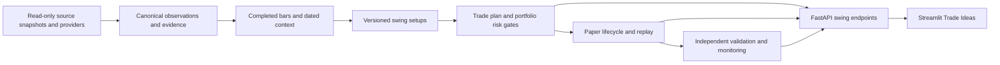

# Swing trading implementation plan

Date: 17 October 2026. Status: S1–S6 tooling implemented; real validation blocked; S6 actual prospective observation unstarted.

Implementation update: **S1–S6 tooling is implemented**. See [the S1 implementation report](SWING_S1_IMPLEMENTATION.md) for source gaps, [the S2 report](SWING_S2_IMPLEMENTATION.md) for setup/risk checks, [the S3 report](SWING_S3_IMPLEMENTATION.md) for ledger/replay evidence, [the S4 report](SWING_S4_IMPLEMENTATION.md) for validation tooling, [the S5 report](SWING_S5_IMPLEMENTATION.md) for UI/operations verification and [the S6 report](SWING_S6_IMPLEMENTATION.md) for forward reconciliation. No strategy has passed real validation. S6 requires actual future sessions; no real campaign or capital has been invented. The planning-phase report below is retained as historical context.

## Outcome and scope

Build an auditable NSE swing-research and paper-trading workflow using the strongest components in the adjacent projects. A result must explain its setup, data vintage, entry conditions, invalidation, position size and portfolio impact. Targets are rule-derived scenarios, not promises. Institutional quality is an engineering and research objective, not a certification or a guaranteed return.

Initial scope is long-only, unlevered cash equities from the configured real NSE universe. Proposed first strategies use completed daily bars and plan entries for the next exchange session. Account capital must be supplied explicitly. Broker order placement, shorting, derivatives, automatic capital deployment and NYSE swing trading require later specifications.

The current RSI/volume/P/E scanner, score explanations, scan-change alerts, NYSE screening and 1/5/10-session performance records retain their existing contracts. Swing detection runs independently across eligible clean bars: a pullback need not first pass the legacy volume-spike/RSI/P/E funnel. Fundamental quality is separate dated context unless a versioned swing strategy explicitly makes it an eligibility rule.

The existing [four-hour breakout plan](BREAKOUT_SCREENER_PLAN.md) remains a distinct strategy proposal. Its complete-only, session-anchored four-hour candle policy is preserved; daily swing plans do not replace or simulate it. Hourly data coverage and publication tests are prerequisites for implementing that strategy. The prior [NSE context plan](NSE_CONTEXT_PLAN.md) supplies compatible 21/63-session strength and dated-context requirements. This document consolidates reuse, risk and validation priorities without rewriting those earlier contracts.

## Evidence already inspected

The source review preceding this plan found these reusable components. Existence and source behavior were inspected; their profitability, current external access and suitability after porting are not yet validated.

| Source | Reuse | Adaptation required |
|---|---|---|
| `D:/Codex/grclaudescript/core/swing.py` | `SwingPlan`, breakout/pullback detection, bounded entries, gap-aware sizing | Extract pure logic; make every decision threshold configurable; use this project's Clock/calendar; version formulas |
| `D:/Codex/grclaudescript/core/alpha_portfolio.py` | Heat, sector and correlation limits | Include the actual held book, available cash, native units and explicit missing-context policy |
| `D:/Codex/grclaudescript/core/swing_replay.py`, `core/backtest.py` | Replay, trade ledger, exit policies and cost accounting | Freeze fill conventions, prevent duplicate/overlapping evaluation, use isolated swing records |
| `D:/Codex/grclaudescript/core/alpha_engine.py`, `core/regime.py` | Relative strength, breadth and regime context | Default benchmark to verified Nifty 500 history; align exact sessions and coverage denominators |
| `D:/Codex/grclaudescript/core/alpha_feeds.py` | Dated sector, surveillance, delivery and earnings observations | Preserve publication/ingestion timestamps and unavailable states; do not imply that feed schemas mean live data exists |
| `D:/Codex/Finding Multibagger NSE/multibagger634-main/lite/delivery.py`, `lite/nse_archives.py` | Bhavcopy parsing, exact-date checks, observed archive evidence | Delivery parser currently excludes non-EQ rows; explicitly handle BE eligibility and missing delivery coverage |
| Same project's `lite/fyers_data.py` | Quotes/history adapter, shared request budget, caching and authorization pauses | Adapt to existing HTTP stack/provider protocols; separate credentials, preserve unknown price basis, data-only endpoints |
| Same project's `lite/history.py`, `lite/financial_reconciliation.py` | Source documents, availability timestamps and NSE/BSE fact reconciliation | Namespaced schema; distinguish statement scope, period, revisions and usable evidence |
| Same project's corporate-action/price-repair modules | Reviewed split/bonus/dividend/identity handling | Preserve evidence and rejected cases; avoid automatic heuristic corrections |

Read-only SQLite aggregate checks observed 612,794 price rows for 634 symbols, dated 2021-10-07 through 2026-10-15, and 2,449,462 delivery rows for 3,340 symbols, dated 2021-01-04 through 2026-10-14. These totals do not establish complete per-symbol histories, a historical Nifty 500 universe, correct adjustments or historical availability.

Reuse selected logic and its tests through explicit adapters. Avoid runtime imports from sibling working directories and avoid sharing mutable SQLite schemas. Pin source revisions/file hashes in a reuse manifest so later changes in those active projects cannot silently change this scanner. Review provenance/dependencies of copied components during S1; secrets, tokens and portfolio-account records are outside the import scope.

## Architecture and ownership



- Supplemental `DailyHistoryProvider` and `ContextProvider` protocols serve swing needs; keep `MarketDataProvider.download_bars/fetch_pe_batch` backward compatible.
- Proposed focused modules: `app/swing/{models,repository,data,indicators,setups,risk,replay,research,service,api}.py`; provider-specific adapters stay under `app/providers/`. Choose final splits when each phase begins.
- Proposed isolated store: `data/swing.db`, with versioned transactional migrations, evidence manifests, scan runs, immutable plans, allocations, fills/events, paper accounts and evaluation runs. Keep existing `data/history.db` and its cohort semantics intact.
- Imported archive snapshots are read-only, consistent SQLite backups or exported batches with source hashes. Canonical rows reference their source documents. Incremental watermarks are committed only with the corresponding import transaction.
- Network/provider calls and imports run off the FastAPI event loop, with bounded timeouts/retries. Reuse the existing global scan lock and scheduler; do not introduce a second polling loop.
- A successful legacy scan may share validated bars with the swing service. Cache keys include provider, identity, interval, price basis, as-of/vintage and required coverage. The existing short daily cache cannot silently truncate a 200-day indicator input.
- UI access stays strictly through HTTP. No direct sibling-database reads or model calculations from Streamlit.

## Data contract and mandatory gates

Each observation carries security identity/ISIN when available, symbol/series, session, interval, currency/units, source, price basis, source timestamp, publication time when verified, ingestion time, availability time, vintage and quality flags.

1. Use explicit adjustment conventions. Raw exchange bars and provider-adjusted bars cannot be spliced into a single series. Features use a consistent action-aware series; executable reference prices and position quantities must reconcile to the raw trading basis. Ambiguous conversions block a paper-entry plan.
2. Retain revisions and original bytes where available. Do not rewrite earlier plans when adjusted history changes. Unexplained discontinuities require review rather than guessed repairs.
3. Align exact exchange sessions. Reject duplicate/conflicting identities, future bars, stale required bars, invalid OHLC relationships and missing required windows. No forward-fill of prices, volume, earnings or delivery data.
4. For contextual information, `usable_at` is no earlier than publication and local ingestion. Unknown historical publication remains unverified; a retrospective archive download does not prove information was available to a historical trader.
5. Use constituents and classifications effective at the decision date. Bhavcopy traded membership is not a complete listed universe or a historical Nifty 500 constituent list. Current-universe retrospective experiments must be labelled accordingly and cannot support a bias-free historical claim.
6. Require adequate benchmark and indicator warm-up coverage. Proposed daily baseline requests at least 400 completed sessions before evaluation; acquisition duration must include holidays and missing sessions. Compute ATR and moving averages on identically prepared live/replay inputs.
7. Delivery context compares the latest 5 completed observations with the preceding 20, with disjoint windows and volume-weighted fractions. Publication timing controls availability. Delivery participation is an accumulation proxy, not evidence of institutional buyer identity.
8. Preserve BE eligibility in the universe. Missing or unsupported BE delivery observations are unknown context; they are not fabricated as 100% and do not silently remove an otherwise eligible equity.
9. Context fields distinguish `available`, `stale`, `unavailable`, `conflicting` and `not_applicable`. Critical uncertainty blocks eligibility for paper entry; a business-rule rejection and a source failure remain distinct.

Core prices, identity, adjustments, calendar, benchmark, capital/risk inputs and required history are critical. Reliable event/surveillance/band coverage is required before any claim of execution readiness; exploratory plans with incomplete optional context remain visibly `RESEARCH_ONLY`. Default broker integration remains disabled and data-only.

## Strategy and trade-plan contract

Implement two frozen daily hypotheses first. Source definitions are a starting point for research, not already demonstrated edges.

| Strategy | Eligibility and timing |
|---|---|
| Daily breakout | Completed close above a configured prior-session high, confirmed volume, rising trend and permitted market regime; exclude the evaluated bar from baselines |
| Daily trend pullback | Established uptrend, controlled retracement and completed-bar reclaim; separate pullback volume rules from breakout rules |

Both record ATR, trend values, 21/63-session excess strength versus Nifty 500, available sector context, entry interval, initial stop, target rationale, maximum holding sessions, entry expiry and rejection reasons. ATR seeding/smoothing and all lookback/inequality conventions must be frozen in the S2 strategy specification and tested against independent references.

Keep source constants as documented research hypotheses until explicitly converted to Settings. Risk thresholds, breakout buffers, extension limits and candle-shape cutoffs cannot remain literals in decision code. Parameter changes create new strategy versions; release evaluation never overwrites old results.

Every immutable plan includes:

- Plan ID, strategy/configuration hash, dataset/evidence hashes, source revision and decision timestamp.
- Symbol/series/identity, data session, source freshness and adjustment basis.
- Setup explanation, passed/failed gates and unavailable context.
- Entry type, minimum/maximum price, first eligible session and expiry.
- Stop/invalidation, target levels with basis, gross/net reward-to-risk and time exit rule.
- Requested risk, allocated quantity, estimated fees/slippage, cash required and portfolio impact.
- Research status, validation record ID, and separate lifecycle status.

Keep model status (`RESEARCH_ONLY`, `VALIDATED_FOR_PAPER`, `SUSPENDED`) separate from trade lifecycle (`CANDIDATE`, `ARMED`, `OPEN`, `CLOSED`, `EXPIRED`, `CANCELLED`). A research-only plan can have replay outcomes; replay outcomes do not promote its model status. Do not expose an `EXECUTION_READY` label in this delivery.

Existing composite score and any new setup ranking have separate meanings. Do not manufacture win probabilities from either score. Imported broker ideas retain their own source, publication price, horizon and missing fields; they do not inherit validation from scanner strategies.

## Risk and fill semantics

Capital is required, finite and positive; never assume a real account balance. Position quantity is the minimum permitted by planned stop-distance risk, available cash including fees, per-position exposure, aggregate open risk, sector exposure, correlation policy and liquidity participation. Missing capital produces a valid research plan with no armed position.

Use the marked held book plus pending reservations when allocating multiple candidates. Freeze deterministic ordering; block double allocation across refreshes. A new scan cannot reset an existing trade's stop or release its reserved capital. Reconcile partial fills, costs, corporate actions, suspended securities and stale marks explicitly.

Provisional paper-research settings to review and freeze during S2:

| Setting | Proposed starting value / policy |
|---|---|
| `SWING_ENABLED` | `false` until integration passes its phase gate |
| `SWING_MODE` | `research`; paper mode requires explicit account configuration and validation status |
| `SWING_CAPITAL_INR` | unset; supplied by user |
| `SWING_MIN_HISTORY_SESSIONS` | 400 completed sessions |
| `SWING_BENCHMARK` | `^CRSLDX`, verified Nifty 500 mapping and basis |
| `SWING_RS_LOOKBACKS` | 21,63 sessions |
| `SWING_RISK_FRACTION` | 0.0025 of marked NAV per new paper position |
| `SWING_MAX_POSITION_FRACTION` | 0.10 |
| `SWING_MAX_GROSS_FRACTION` | 0.60 |
| `SWING_MAX_OPEN_RISK_FRACTION` | 0.015 |
| `SWING_MAX_SECTOR_FRACTION` | 0.25; missing taxonomy blocks allocation under this gate |
| `SWING_MAX_ADV_PARTICIPATION` | 0.005 of prior completed-session average observed share volume |
| `SWING_MIN_NET_RR` | 1.5 after modeled entry/exit costs; provisional research floor, not a guarantee |
| `SWING_ENTRY_VALID_SESSIONS` | 1 next exchange session |
| `SWING_BREAKOUT_MAX_HOLD`, `SWING_PULLBACK_MAX_HOLD` | 10,5 completed holding sessions before the specified time-exit instruction |

These are conservative engineering starting hypotheses, not universal institutional standards or personalized investment limits. S2 must document the complete defaults, bounds, units and interactions in `.env.example` and the master spec before coding decision rules. Research comparisons may test alternatives only inside the training protocol.

Cost and target rules must agree: the source's gross 2R target yields less than 2R after costs. Do not claim a net 2R opportunity from that target, or extend a target merely to pass the gate. Compare the declared exit policy's net payoff with the configured floor and reject unattractive plans.

Initial paper execution policy:

- Generate only from completed bars, after source availability. Entry is the next eligible session's actual open if it lies in the frozen entry interval and passes risk/cash gates. Otherwise record an unfilled/expired order. Do not infer an intraday entry from a daily high/low touch.
- Simulated intraday stop/target exits from daily bars are labelled OHLC approximations. If both are touched, use the predeclared adverse stop-first convention and separately report an ambiguity sensitivity result. A mere target touch does not prove executable volume.
- A gap below the stop exits at the adverse available open plus slippage, subject to tradability. Circuit lock/suspension or missing bars can leave a position unresolved; do not force a stop-price fill. Actual loss may exceed planned stop risk.
- Time exits use a known, predeclared order convention. Baseline: after the holding-limit close, exit at the next tradable open; do not use a newly observed closing price as a retrospective fill.
- Use trading-basis prices for execution, split-aware quantities, entry/exit cash-flow fees, and conservative slippage/impact sensitivity. Cost versions are recorded per evaluation. Benchmark and dividend conventions are explicit.
- Research plans may display a stop/target with missing execution context, but cannot become armed paper positions through an unchecked path. No broker order endpoints are introduced.

## Ordered implementation phases

Complete one phase at a time. The current authorization creates this plan only. Each subsequent phase starts after `CONTINUE`, rereads `docs/SPEC.md`, freezes its exact scope and ends with real results plus a handoff.

| Phase | Deliverables | Completion gate |
|---|---|---|
| **S1 — Data and provenance** | Source revision/hash manifest; supplemental protocols; canonical observations; isolated schema; read-only price/delivery imports; coverage/identity/basis report; dated context contract | Import is idempotent, source DBs untouched, no mixed price basis, exact-date/identity/unknown tests pass; missing histories and benchmark coverage quantified |
| **S2 — Setups and risk plans** | Native indicators; two versioned daily setups; independent swing funnel; entry/stop/target/time rules; position/portfolio allocation; research-only API | No-look-ahead invariance, independent indicator checks, risk/cash/sector/liquidity boundaries, gap rejection and deterministic ranking pass; legacy behavior remains compatible |
| **S3 — Replay and lifecycle** | Immutable plans; orders/reservations/fills/event ledger; paper lifecycle; costs/action-aware execution; NAV/benchmark tracking; shared-lock scheduling | Cash/quantity conservation, no duplicate orders after restart, adverse gap/ambiguous-bar cases, failure recovery and audit reconstruction pass |
| **S4 — Independent validation** | Frozen walk-forward design, benchmark comparison, parameter/cost stress, uncertainty and failure analysis; signed evaluation manifests | Untouched evaluation data, clear universe/publication limitations, reproducible results and predeclared promotion criteria; insufficient evidence stays research-only |
| **S5 — Trade Ideas UI and operations** | Compact cards/detail charts; source/quality panel; setup filters; risk allocation; research/paper results; source status; idempotent lifecycle alerts; pause/rollback controls | HTTP-only UI, readable narrow layouts, stale/unavailable states, result/export consistency, UI tests and real-browser verification; no order placement |
| **S6 — Prospective paper validation** | Forward-captured observations and plans; daily reconciliation; predicted/observed fill comparison; monitored paper report | At least 30 actual trading sessions observed as a minimum operational window, sufficient trades/regimes for the predeclared statistical gate, no unresolved critical integrity failures; elapsed time alone never establishes an edge |

S1 should prefer existing consistent archive snapshots before adding network load. The FYERS adapter can be developed against recorded/synthetic tests but live use requires an independently configured valid data session. Current API availability and licensed usage remain separate verification items. No paid upgrades or copied source-project credentials are assumed.

Effort should be re-estimated after S1 coverage results; source reuse reduces coding effort but does not eliminate validation. S6 requires calendar time and cannot be replaced by faster historical simulation. The four-hour strategy can be added as a separately authorized phase after its hourly-data gate, with its own strategy ID, benchmark timing and replay policy.

## Research evaluation and promotion

Write the hypothesis, feature set, parameter search budget, train/validation/test boundaries, metrics, failure thresholds and intended trading capacity before evaluation. Keep an untouched terminal test set. Time-ordered folds need purging/embargo where labels or holding periods overlap; deduplicate overlapping test-date results.

Use only information available at each simulated decision, including dated constituents, sector classifications, events, financial revisions and cost assumptions. Existing current P/E values cannot be applied to older signals as historical facts. Missing verified history is reported as a limitation, not filled with today's universe/metadata.

Report net expectancy in R and currency, win/loss distribution, payoff ratio, turnover, exposure, average duration, maximum drawdown, drawdown duration, benchmark-relative returns, capacity and rejection/fill coverage. Compare strategies against the benchmark and simple frozen baselines at comparable capital/exposure. Include calendar-marked portfolio drawdowns, not just summaries of closed winners/losers.

Cluster uncertainty estimates by signal date/block to account for common-market moves and overlapping trades. Disclose the number of independent periods, sample size, sectors/regimes and all tested variants. Win rate alone cannot promote a strategy. Stress adverse slippage/costs, delayed fills, gaps, halts and parameter perturbations.

Promotion to `VALIDATED_FOR_PAPER` requires a reproducible held-out report, positive net expectancy with its prespecified uncertainty test, acceptable predeclared drawdown/exposure limits, stable neighboring parameters and no critical data/fill violations. Thresholds and sample sufficiency are specified before the holdout is opened; failure cannot be cured by tuning that same holdout. Research-only prospective logging is permitted when historical evidence is incomplete, with no implied recommendation or trade eligibility.

Institutional principles informing these gates: [CFA Institute backtesting and simulation](https://www.cfainstitute.org/insights/professional-learning/refresher-readings/2026/backtesting-and-simulation), [CME position-sizing framework](https://www.cmegroup.com/education/courses/trade-and-risk-management/proper-position-size), and [NSE surveillance information](https://www.nseindia.com/static/market-data/price-bands-surveillance-actions). The concrete settings above are this project's proposals, not thresholds mandated by these sources.

## API and user experience

Proposed endpoint family `/api/swing/*`: `results`, `status`, `refresh`, `plans/{id}`, `portfolio`, `paper/events`, `performance`, `data-quality` and `export.csv`. Final request/response contracts belong to the implementing phase; mutations must validate state/version and be idempotent. Preserve 202/404/422/429 market/lock conventions where applicable. Reads do not trigger provider downloads.

The compact Trade Ideas card shows setup, data date, latest/reference price distinction, entry interval, stop, targets, planned net reward/risk, expiry and an explicit research/paper status. Details show evidence, missing data, price chart with levels, allocation constraints and validation sample. A blank/unknown value is preferable to a false recommendation. No portfolio account means no fabricated quantity.

Separate daily swing, complete four-hour breakout and imported longer-horizon broker research with visible strategy/horizon labels. A 3–6-month price target cannot be presented as a validated 5–10-session swing exit. New-signal alerts can be extended through the existing webhook service; outbound destinations require user configuration, and paper actions never imply broker fills.

## Validation matrix and rollback

Mandatory tests include partial/future bars, calendar holidays/overrides, warm-up, missing sessions, malformed feeds, publication-after-decision, revised data vintages, universe changes, benchmark gaps, price-basis conflicts, split/bonus/dividend transitions, BE delivery gaps and unknown classifications.

Risk/replay tests cover insufficient cash, zero-share allocation, simultaneous signals, pending reservations, correlated positions, oversized gaps, stop/target ambiguity, circuits, stale marks, delisting/unresolved outcomes, partial fills, time exits and adverse costs. Independently recompute selected ledger cash flows and check that reports reconstruct from events after restart.

Use synthetic fixtures only in tests/offline contexts. An integration test that imports archived real data stays explicitly separate from synthetic fixtures and never fabricates missing records. Mark external live checks separately; run them only in the intended market window, with bounded requests and actual results retained.

Maintain an opt-in feature flag, transactional migrations/backups and reversible version selection. Rollback disables swing evaluation/arming and retains prior plans/events for audit. Existing open paper positions require reconciliation/exit handling; disabling scanning must not silently erase their liabilities or fabricate closure. Existing scanner snapshots/history remain usable.

## Known constraints and decisions before implementation

- Source coverage, corporate-action basis, historical constituent membership and benchmark depth must be established per symbol/session. Stored row totals are not release evidence.
- Some source modules use fixed thresholds, wall-clock calls, different schemas/benchmarks and dependencies outside the pinned stack. Port logic into current Settings/Clock/httpx conventions; do not import whole applications.
- The source delivery refresher starts with yesterday's date. A post-close integration must instead determine the latest available completed session using the calendar and publication policy, with explicit same-day/holiday/late-publication tests.
- NSE endpoint access previously failed in this scanner; source adapters and explicit unavailable states are essential. A cached document proves observation, not verified publication at a historical timestamp.
- The earlier preview kept nightly evaluation paused. S5 must expose and verify actual scheduler status; S6 cannot depend on an inadvertently disabled preview loop. Do not silently turn on unrelated NYSE scans.
- Existing uncommitted changes in `app/main.py` and `tests/test_api.py` were present at the start of planning. This phase leaves them intact; inspect their current diff and run a fresh baseline before S1 integration.
- No blocker prevents writing this plan. Historical data/entitlements/validation may limit later release status; those limitations must become visible gate results rather than promises of completeness.

## Planning phase report

Created: `docs/SWING_TRADING_PLAN.md` only. No runtime functions, configuration keys, databases or source projects were changed in this planning phase. Proposed components and settings above are not claims of implementation.

Commands/actions executed: read `AGENTS.md` and `docs/SPEC.md`; CodeGraph exploration of current models/state/performance/integration points; read existing breakout/context/feature roadmaps; `Get-ChildItem docs -File`; `git status --short`; `git diff --check`; and a local Markdown reference/structure check after writing the plan.

Tests: no application tests executed for this documentation-only phase. Source-project test files were inspected during the preceding reuse review; their existence does not mean those tests passed here. The previous 208-test result is historical and is not a fresh baseline for the current working tree.

VERIFIED: current integration contracts and existing planning documents; source components inspected in the preceding review; read-only stored coverage totals; plan references/structure checked. NOT VERIFIED: ported implementations, current provider access, source-data correctness/completeness, historical availability, statistical edge, actual fills, or institution-ready status.

Assumptions: NSE cash delivery and completed daily bars are the first proposed swing scope; current universe remains user-supplied; account capital is explicit; four-hour breakout retains its separate contract; no broker execution is included; every later phase needs `CONTINUE`.

| SPEC section | Status | Planning compliance |
|---|---|---|
| 0/22: phase discipline/report | Done | Planning phase only; evidence, limits and handoff included |
| 1/6/9/10/12: strategy/universe | Done | Existing scanner unchanged; separate strategies and dated universes planned |
| 2/3/5/7/8: data/stack/config | Done | No fabricated observations or new dependencies; adaptations and gates explicit |
| 14/15/17/18: storage/scheduler/API/UI | Not in this phase | Proposed contracts preserve separation, worker I/O and HTTP-only UI |
| 20: tests | Not in this phase | No runtime edits; document checks only; implementation requires fresh baseline |
| 23–25: existing extensions | Done | Existing context, alerts and score insights retain meaning |

## STATE SUMMARY

```text
Completed phase: swing trading and cross-project reuse planning, 16 Oct 2026.
Created docs/SWING_TRADING_PLAN.md: architecture, source map, six phases and gates.
Runtime files/functions/classes/config keys added: none.
Existing app/main.py and tests/test_api.py changes preserved.
Sources: grclaudescript swing/risk/replay; multibagger price/delivery/evidence.
Decision: separate swing universe pipeline; keep legacy RSI/P/E funnel intact.
Decision: NSE long-only unlevered cash delivery; daily completed-bar baseline.
Decision: preserve separate complete-only four-hour breakout strategy contract.
Decision: explicit capital, immutable plans, isolated swing store and evidence.
Decision: research/paper status is independent of candidate/trade lifecycle.
Decision: versioned configurable hypotheses; no invented success probabilities.
Decision: per-source adjustment, availability, identity and session checks.
Decision: no broker order placement or credentials copied from sibling projects.
S1: read-only source snapshots, coverage/basis/provenance contracts and imports.
S2: indicators, two setups, trade plans and portfolio risk allocation.
S3: conservative fills, costs, paper lifecycle and event-ledger replay.
S4: held-out walk-forward validation, uncertainty and stress gates.
S5: compact HTTP-only Trade Ideas UI, alerts, operations and rollback.
S6: actual forward paper capture/reconciliation and monitored validation.
Tests this phase: no application tests; Markdown/reference/whitespace checks only.
Known limits: provider access, price basis, PIT membership and edge unverified.
Known limits: data totals do not prove per-symbol or historical completeness.
Next first step after CONTINUE: reread SPEC, inspect current dirty diff, run a
fresh isolated baseline; then freeze S1 contracts/source manifests before imports.
Stopped after planning; no implementation phase started.
```
